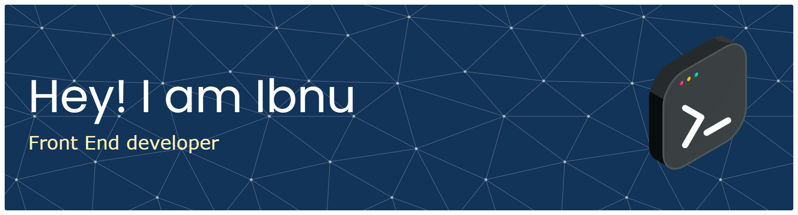

<!--
**Tiannn-r/Tiannn-r** is a ✨ _special_ ✨ repository because its `README.md` (this file) appears on your GitHub profile.

Here are some ideas to get you started:

- 🔭 I’m currently working on ...
- 🌱 I’m currently learning ...
- 👯 I’m looking to collaborate on ...
- 🤔 I’m looking for help with ...
- 💬 Ask me about ...
- 📫 How to reach me: ...
- 😄 Pronouns: ...
- ⚡ Fun fact: ...
-->
<h1 data-importer="text" align="left">Hallo salam kenal !</h1>

###

Halo nama saya Ibnu, saya adalah seorang junior website dan front end developer, dari Bandung

###

<h2 data-importer="text" align="left">Tentang Saya</h2>

###

✨ Tertarik dalam dunia progamming sejak 2024 📚 Saya sedang memperdalam JavaScript, PHP, dan sedang mempelajari tentang dasar menjadi seorang FullStack developer 🎯 Goals: Menjadi seorang profesional Fullstack developer dan bisa memberikan ilmu yang dipunya kepada orang banyak, sekaligus dapat berguna dalam dunia teknologi dimasa depan 🎲 Fun fact: Masuk dunia teknologi bukan tujuan awal saya

###

<h2 data-importer="text" align="center">Tech Stack</h2>

###

  
  
  
  
  
  
  
  
  
  
  
  
  
  
  
  
  
  
  
  
  
  
  
  
  

###

###
